# Replate Food Rescue Platform - UML Architecture & Specification Diagrams

This directory contains the complete set of UML diagrams and architectural specifications for the **Replate Food Rescue Platform**, modeled and rendered using PlantUML.

All diagrams are available in three formats:
1. **Source Code (`.puml`)**: Editable text-based PlantUML source.
2. **Vector Graphic (`.svg`)**: Scalable, high-fidelity vector format for web & documentation.
3. **Raster Graphic (`.png`)**: High-resolution raster format for presentations, GitHub Wiki, Confluence, and Notion.

---

## Table of Contents

| # | Diagram Name | Category | PlantUML Source | Vector (SVG) | Image (PNG) |
|---|---|---|---|---|---|
| 01 | **[System Use Case Diagram](#01-system-use-case-diagram)** | Behavioral / Requirements | [`01_use_case_diagram.puml`](01_use_case_diagram.puml) | [SVG](images/01_use_case_diagram.svg) | [PNG](images/01_use_case_diagram.png) |
| 02 | **[Domain Model & Service Class Diagram](#02-domain-model--service-class-diagram)** | Structural / OOP Design | [`02_class_diagram.puml`](02_class_diagram.puml) | [SVG](images/02_class_diagram.svg) | [PNG](images/02_class_diagram.png) |
| 03 | **[End-to-End Donation & Delivery Lifecycle](#03-end-to-end-donation--delivery-lifecycle)** | Behavioral / Sequence | [`03_sequence_donation_lifecycle.puml`](03_sequence_donation_lifecycle.puml) | [SVG](images/03_sequence_donation_lifecycle.svg) | [PNG](images/03_sequence_donation_lifecycle.png) |
| 04 | **[Algorithmic Matching & Scoring Sequence](#04-algorithmic-matching--scoring-sequence)** | Behavioral / Sequence | [`04_sequence_matching_engine.puml`](04_sequence_matching_engine.puml) | [SVG](images/04_sequence_matching_engine.svg) | [PNG](images/04_sequence_matching_engine.png) |
| 05 | **[Driver Dispatch, Live Telemetry & Routing](#05-driver-dispatch-live-telemetry--routing)** | Behavioral / Sequence | [`05_sequence_driver_dispatch.puml`](05_sequence_driver_dispatch.puml) | [SVG](images/05_sequence_driver_dispatch.svg) | [PNG](images/05_sequence_driver_dispatch.png) |
| 06 | **[Donation Lifecycle State Machine](#06-donation-lifecycle-state-machine)** | Behavioral / Statechart | [`06_state_donation_lifecycle.puml`](06_state_donation_lifecycle.puml) | [SVG](images/06_state_donation_lifecycle.svg) | [PNG](images/06_state_donation_lifecycle.png) |
| 07 | **[Driver Availability & Delivery State Machine](#07-driver-availability--delivery-state-machine)** | Behavioral / Statechart | [`07_state_delivery_driver.puml`](07_state_delivery_driver.puml) | [SVG](images/07_state_delivery_driver.svg) | [PNG](images/07_state_delivery_driver.png) |
| 08 | **[Algorithmic Matching Decision Flow](#08-algorithmic-matching-decision-flow)** | Behavioral / Activity | [`08_activity_matching_algorithm.puml`](08_activity_matching_algorithm.puml) | [SVG](images/08_activity_matching_algorithm.svg) | [PNG](images/08_activity_matching_algorithm.png) |
| 09 | **[Delivery & Dual-Party Handover Workflow](#09-delivery--dual-party-handover-workflow)** | Behavioral / Activity (Swimlanes) | [`09_activity_delivery_handover.puml`](09_activity_delivery_handover.puml) | [SVG](images/09_activity_delivery_handover.svg) | [PNG](images/09_activity_delivery_handover.png) |
| 10 | **[System Component Architecture](#10-system-component-architecture)** | Structural / Architecture | [`10_component_architecture.puml`](10_component_architecture.puml) | [SVG](images/10_component_architecture.svg) | [PNG](images/10_component_architecture.png) |
| 11 | **[Deployment & Infrastructure Topology](#11-deployment--infrastructure-topology)** | Structural / Infrastructure | [`11_deployment_infrastructure.puml`](11_deployment_infrastructure.puml) | [SVG](images/11_deployment_infrastructure.svg) | [PNG](images/11_deployment_infrastructure.png) |
| 12 | **[Modular Package Architecture](#12-modular-package-architecture)** | Structural / Packaging | [`12_package_structure.puml`](12_package_structure.puml) | [SVG](images/12_package_structure.svg) | [PNG](images/12_package_structure.png) |
| 13 | **[Relational Database Schema (ERD)](#13-relational-database-schema-erd)** | Data / Entity-Relationship | [`13_er_database_schema.puml`](13_er_database_schema.puml) | [SVG](images/13_er_database_schema.svg) | [PNG](images/13_er_database_schema.png) |
| 14 | **[Time-Critical Expiry & Dispatch Timing](#14-time-critical-expiry--dispatch-timing)** | Behavioral / Timing | [`14_timing_match_dispatch.puml`](14_timing_match_dispatch.puml) | [SVG](images/14_timing_match_dispatch.svg) | [PNG](images/14_timing_match_dispatch.png) |
| 15 | **[Driver Mission Control UI Wireframe (Salt)](#15-driver-mission-control-ui-wireframe-salt)** | UI / Wireframe | [`15_salt_wireframe_driver_dashboard.puml`](15_salt_wireframe_driver_dashboard.puml) | [SVG](images/15_salt_wireframe_driver_dashboard.svg) | [PNG](images/15_salt_wireframe_driver_dashboard.png) |

---

## Detailed Diagrams & Previews

### 01. System Use Case Diagram
Models platform actors (Donors, Recipient NGOs, Volunteer Drivers, System Administrators, and Automated Schedulers) and their core operational capabilities.
- **Source:** [`01_use_case_diagram.puml`](01_use_case_diagram.puml)
- **Rendered Image:**
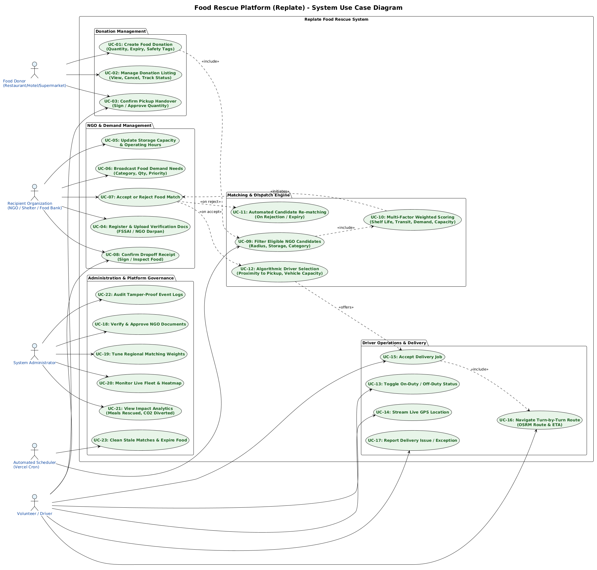

---

### 02. Domain Model & Service Class Diagram
Defines the SQLAlchemy / Pydantic domain models, data relationships, enums (`DonationStatus`, `DeliveryStatus`, `UserRole`), and core service interfaces (`IMatchingEngine`, `IDispatchService`, `IRoutingService`).
- **Source:** [`02_class_diagram.puml`](02_class_diagram.puml)
- **Rendered Image:**
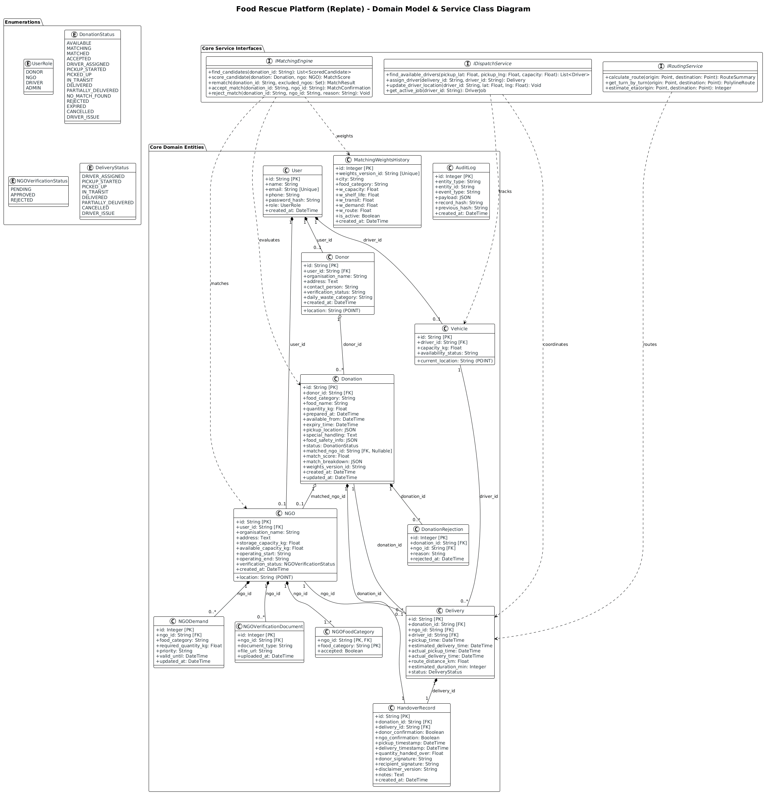

---

### 03. End-to-End Donation & Delivery Lifecycle
Captures the chronological flow from Donor listing creation -> candidate evaluation -> NGO offer review -> driver dispatch -> pickup verification -> in-transit tracking -> dropoff completion.
- **Source:** [`03_sequence_donation_lifecycle.puml`](03_sequence_donation_lifecycle.puml)
- **Rendered Image:**
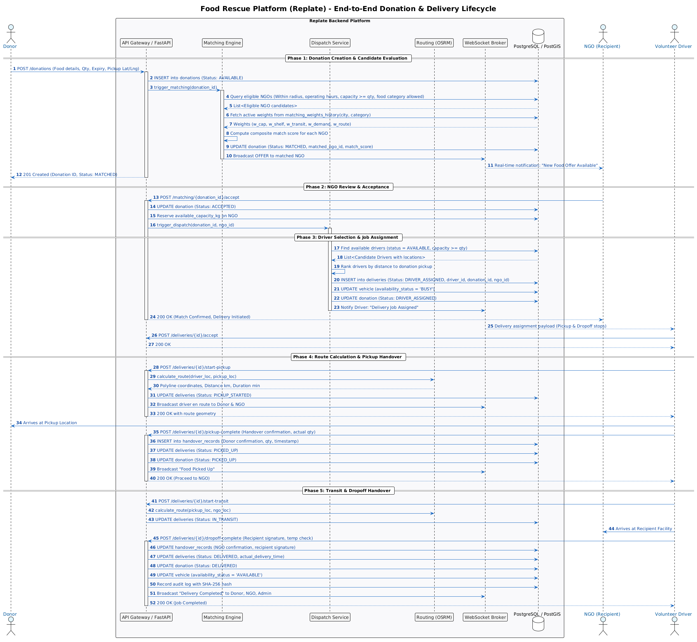

---

### 04. Algorithmic Matching & Scoring Sequence
Details the multi-factor scoring algorithm, candidate hard-filtering (operating hours, available capacity, food category whitelist, radius constraints), regional weight versioning, and rematch handling.
- **Source:** [`04_sequence_matching_engine.puml`](04_sequence_matching_engine.puml)
- **Rendered Image:**
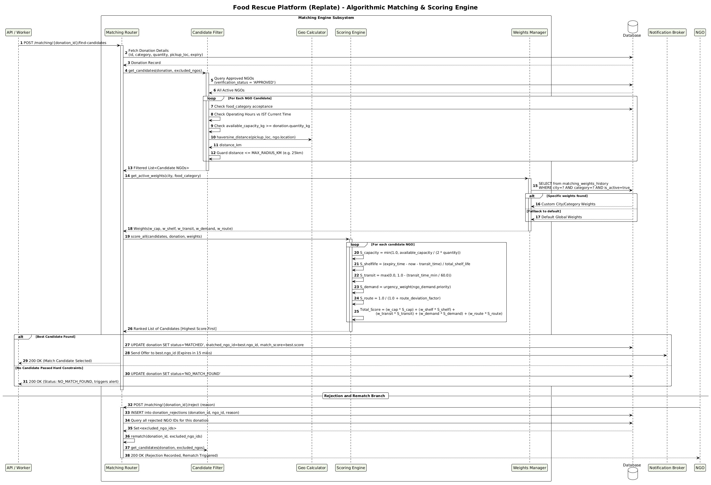

---

### 05. Driver Dispatch, Live Telemetry & Routing
Illustrates driver duty toggle, periodic GPS ping broadcasting, dispatch allocation ranked by proximity, and turn-by-turn routing with OSRM polylines.
- **Source:** [`05_sequence_driver_dispatch.puml`](05_sequence_driver_dispatch.puml)
- **Rendered Image:**
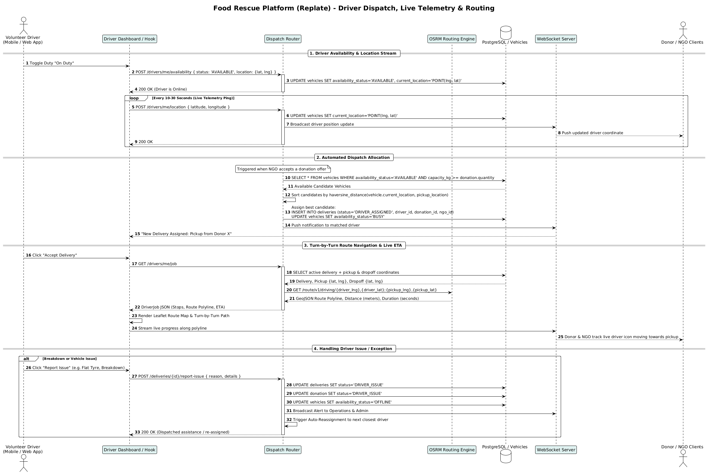

---

### 06. Donation Lifecycle State Machine
Models all valid states and transitions for food listings: `AVAILABLE`, `MATCHING`, `MATCHED`, `ACCEPTED`, `DRIVER_ASSIGNED`, `PICKUP_STARTED`, `PICKED_UP`, `IN_TRANSIT`, `DELIVERED`, `PARTIALLY_DELIVERED`, `NO_MATCH_FOUND`, `REJECTED`, `EXPIRED`, and `DRIVER_ISSUE`.
- **Source:** [`06_state_donation_lifecycle.puml`](06_state_donation_lifecycle.puml)
- **Rendered Image:**
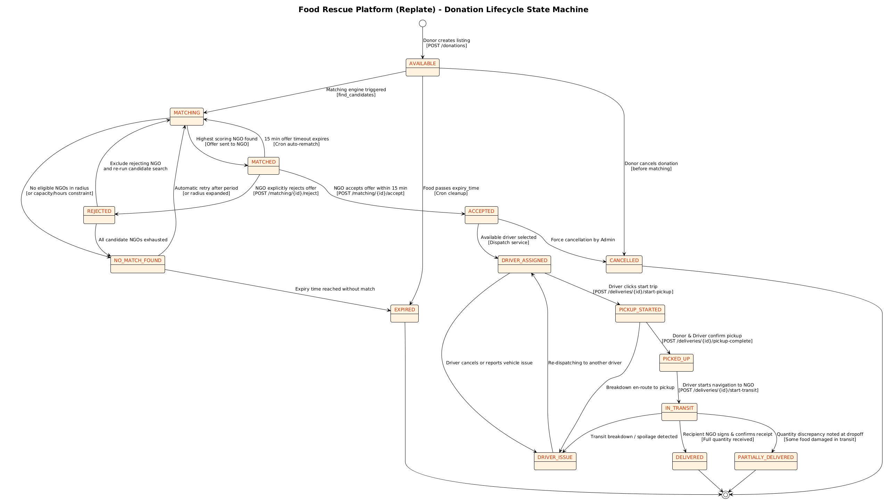

---

### 07. Driver Availability & Delivery State Machine
Visualizes the concurrent state machines for driver availability (`OFFLINE`, `AVAILABLE`, `BUSY`) and real-time delivery execution states.
- **Source:** [`07_state_delivery_driver.puml`](07_state_delivery_driver.puml)
- **Rendered Image:**
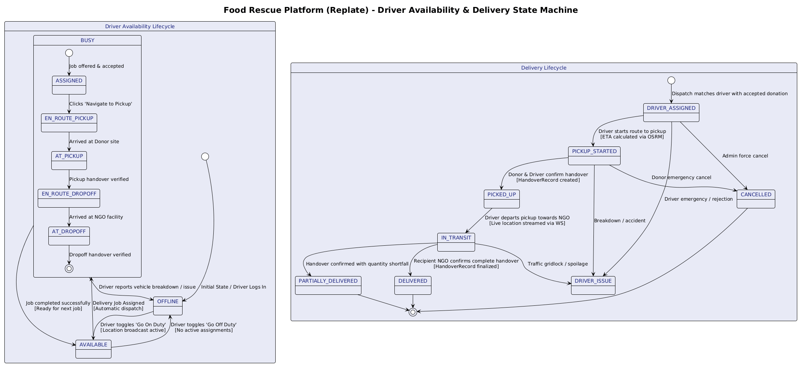

---

### 08. Algorithmic Matching Decision Flow
An activity diagram demonstrating the exact decision tree used by the backend matching engine to filter, score, and rank NGOs, along with 15-minute offer timeouts.
- **Source:** [`08_activity_matching_algorithm.puml`](08_activity_matching_algorithm.puml)
- **Rendered Image:**
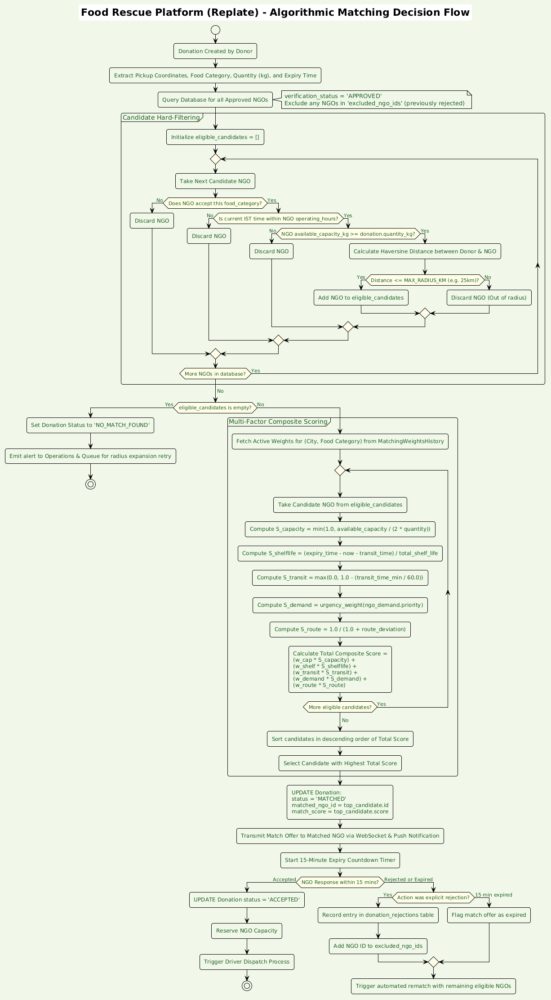

---

### 09. Delivery & Dual-Party Handover Workflow
A swimlane activity diagram across Donor, Volunteer Driver, Backend System, and Recipient NGO demonstrating digital signatures, quantity checks, temperature logging, and SHA-256 audit trails.
- **Source:** [`09_activity_delivery_handover.puml`](09_activity_delivery_handover.puml)
- **Rendered Image:**
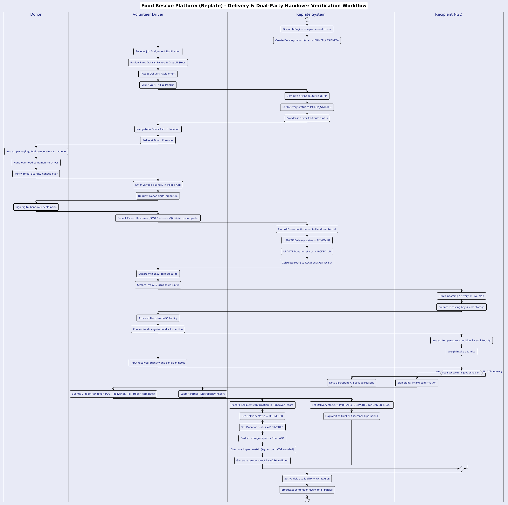

---

### 10. System Component Architecture
Depicts frontend SPA modules, FastAPI backend components, database tiers, and external routing and geocoding services.
- **Source:** [`10_component_architecture.puml`](10_component_architecture.puml)
- **Rendered Image:**
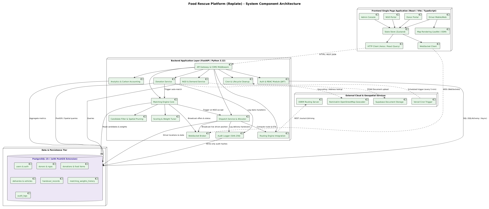

---

### 11. Deployment & Infrastructure Topology
Illustrates physical and cloud hosting environments: Vercel Edge CDN, Python ASGI container, Supabase Managed PostgreSQL with PostGIS, OSRM routing server, and mobile client apps.
- **Source:** [`11_deployment_infrastructure.puml`](11_deployment_infrastructure.puml)
- **Rendered Image:**
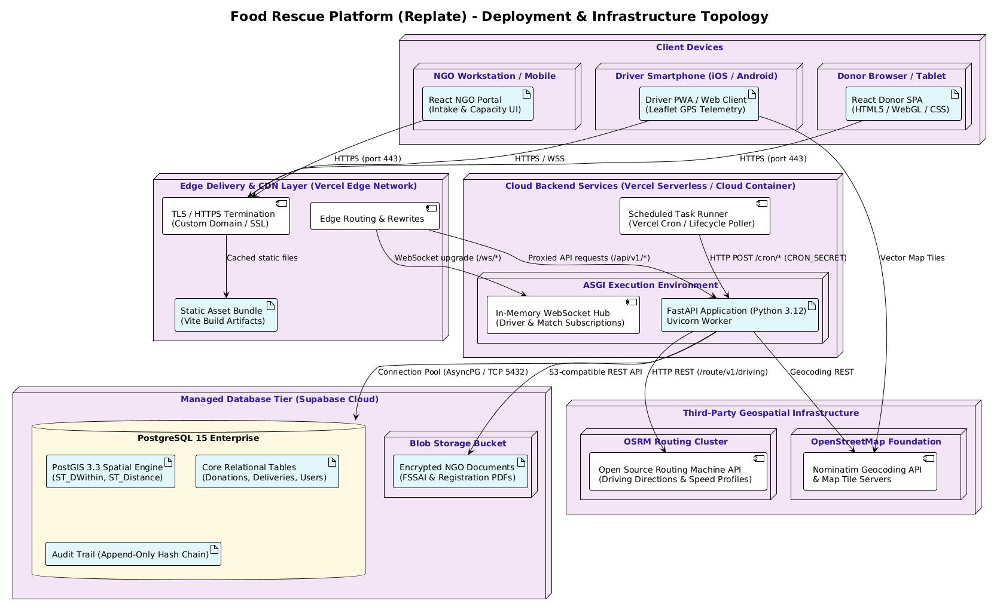

---

### 12. Modular Package Architecture
Maps Python packages (`app.core`, `app.models`, `app.matching_engine`, `app.dispatch`, `app.routing`, etc.) and frontend directory structure (`components`, `pages`, `hooks`).
- **Source:** [`12_package_structure.puml`](12_package_structure.puml)
- **Rendered Image:**
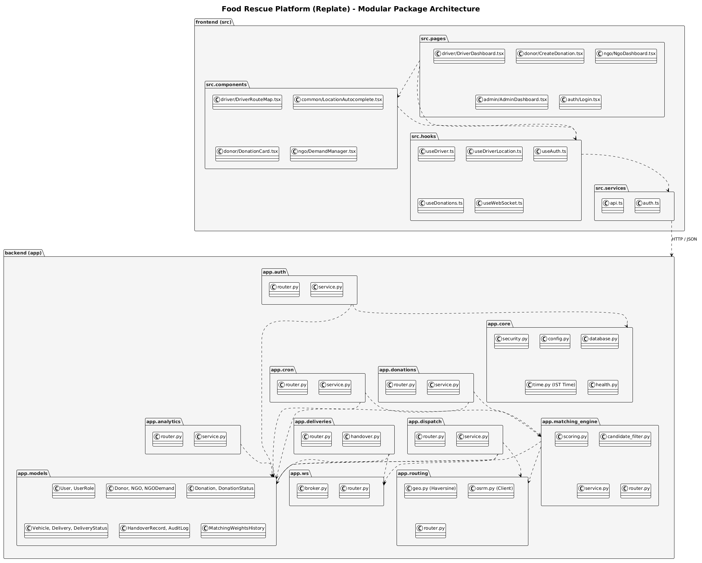

---

### 13. Relational Database Schema (ERD)
Complete entity-relationship diagram of all PostgreSQL tables, column types, primary keys, foreign keys, and cardinalities.
- **Source:** [`13_er_database_schema.puml`](13_er_database_schema.puml)
- **Rendered Image:**
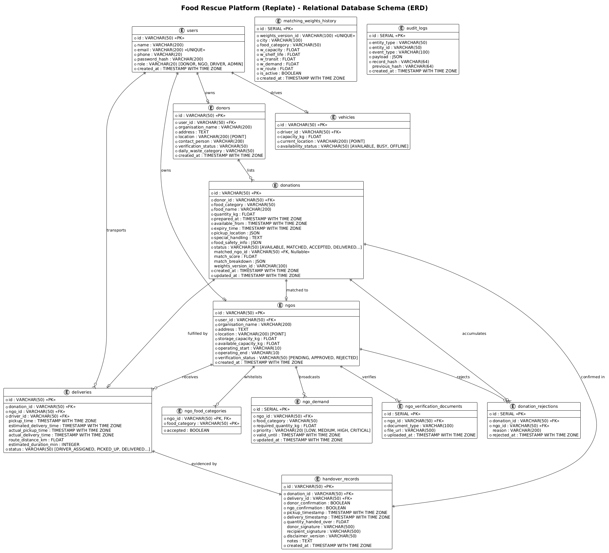

---

### 14. Time-Critical Expiry & Dispatch Timing
A timing diagram highlighting time-sensitive SLAs: shelf-life decay, 15-minute NGO claim windows, 5-minute driver acceptance deadlines, and transit durations.
- **Source:** [`14_timing_match_dispatch.puml`](14_timing_match_dispatch.puml)
- **Rendered Image:**
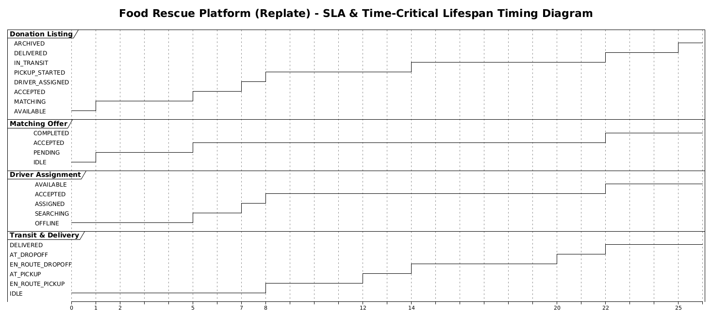

---

### 15. Driver Mission Control UI Wireframe (Salt)
PlantUML Salt graphical wireframe representing the driver dashboard: active assignment details, GPS broadcaster, coordinate lock, and live map view.
- **Source:** [`15_salt_wireframe_driver_dashboard.puml`](15_salt_wireframe_driver_dashboard.puml)
- **Rendered Image:**
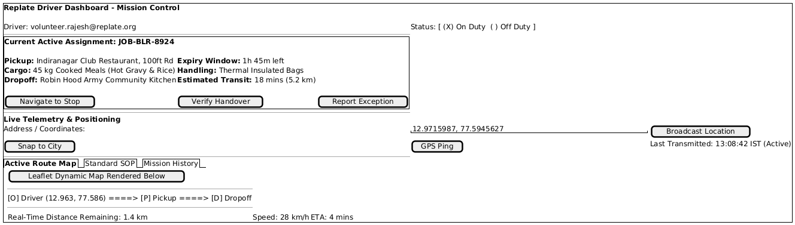

---

## Generating & Re-rendering Diagrams

To re-render all diagrams after modifying any `.puml` file, run:

```bash
python scripts/render_puml.py docs/diagrams docs/diagrams/images
```
